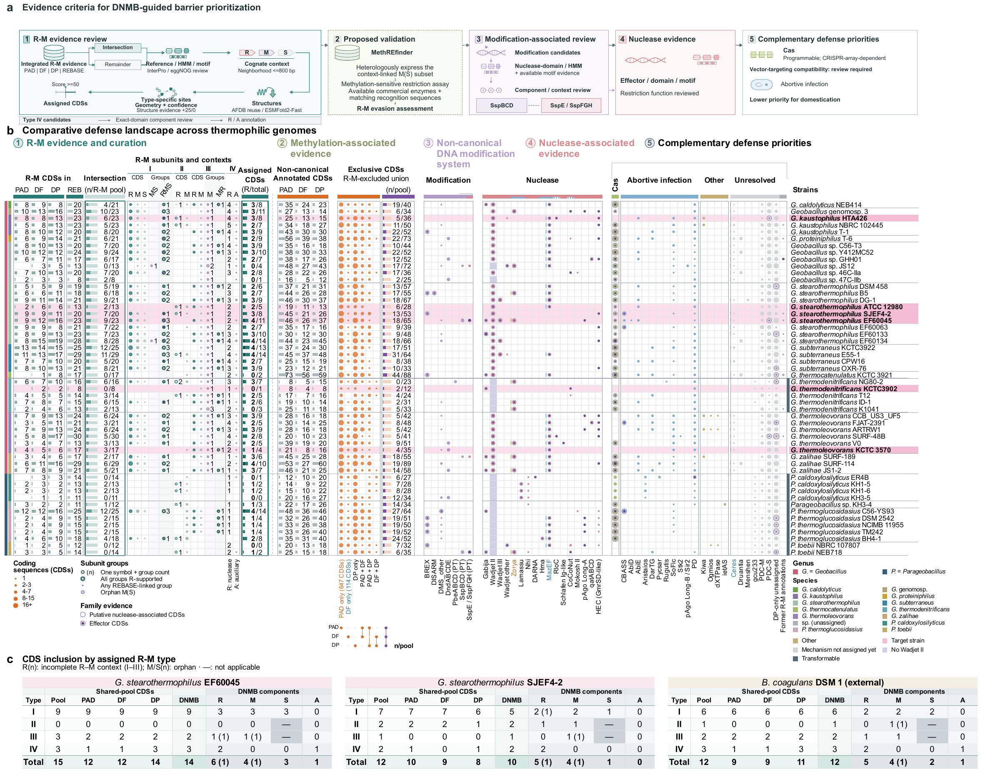
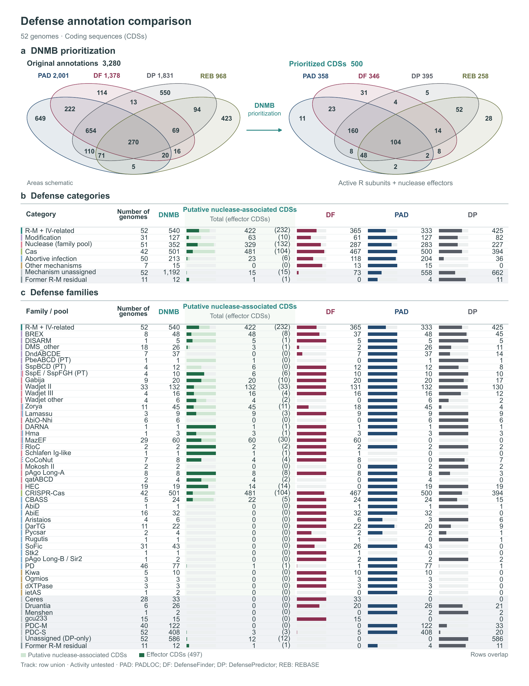

# DefenseViz

Analyze DNMBsuite results and export classified annotations, Excel summaries and editable figures.

DefenseViz combines DNMB R–M evidence with saved defense annotations. It produces a defense landscape, R–M type tables, source-overlap plots and family comparisons, together with the CDS lists behind each figure.

## Example results

Reviewed 52-genome Geobacillus benchmark, including supplied context-review annotations. Sample highlights belong to this study; new runs use their own sample labels and annotations.

[](docs/assets/benchmark52/atlas.svg)

<details>
<summary>Source overlap, prioritization and family comparisons</summary>

[](docs/assets/benchmark52/comparison.svg)

</details>

[Full PDF](docs/assets/benchmark52/publication.pdf) · [Atlas SVG](docs/assets/benchmark52/atlas.svg) · [Comparison SVG](docs/assets/benchmark52/comparison.svg) · [R–M assignment flow](docs/assets/benchmark52/rm-assignments.svg) · [Example details](docs/example-results.md)

## First installation

The recommended full-analysis installation needs Python 3.10+, Git and a running
Linux Docker engine: Docker Desktop on macOS, Docker Engine on Linux, or Docker
inside Windows WSL. Allow about 40 GB of free disk space for the shared tool image
and references, and at least 8 GB of Docker memory. Apple Silicon runs the pinned
Linux amd64 tools through emulation.

```sh
git clone https://github.com/JAEYOONSUNG/DefenseViz.git
cd DefenseViz
python3 -m venv .venv
. .venv/bin/activate
python -m pip install '.[suite]'
defenseviz setup
```

Run setup from the checkout, or pass `--source /path/to/DefenseViz`. It builds the
native runtime from public source, downloads the official REBASE protein snapshot
and pinned R–M HMM provider release, prepares the indexes, and verifies the complete
resource set. No previous workstation, benchmark folder, manual database copy or
host R installation is needed.

The runtime profile and references are stored in `~/.cache/defenseviz` (or
`$XDG_CACHE_HOME/defenseviz`). Set `DEFENSEVIZ_CACHE` to use another persistent
location for **both setup and analysis**. A repeated setup validates and reuses
the existing files without downloading the databases again. Use
`defenseviz setup --refresh-databases` only when intentionally acquiring a new
reference snapshot; previous snapshots are preserved. The public REBASE provider
uses anonymous FTP; hashes record the acquired snapshot, not a historical release
or authenticated transport. See [first-install details](docs/first-install.md).

Try the synthetic example without installing databases or the native analysis tools:

```sh
defenseviz demo --suite --out suite-demo
```

Open `suite-demo/results/figures/publication.pdf`. The demo uses synthetic data; the benchmark figures above are a separate reviewed dataset.

## Analyze DNMBsuite results

After setup, give DefenseViz a completed DNMBsuite result folder or the parent
containing several per-genome folders:

```sh
defenseviz from-suite /path/to/DNMBsuite_outputs --out results
```

That one command uses the saved runtime and cached databases, discovers the
samples, performs fresh R–M searches, and writes the Excel/TSV tables and all
PDF/SVG/PNG figures. No conversion or separate plotting command is needed.
The complete native `*_total.xlsx` workbook supplies annotations automatically;
explicit input manifests remain available for selecting a different source.
Keep the result directory outside the input parent and use a new output name
for each run. Open `results/figures/publication.pdf`.

An existing explicit engine configuration takes precedence over the managed
runtime. Advanced native installations and projects with external execution
settings can use the [native runtime](docs/runtime-install.md) or direct
[container commands](docs/dnmbsuite-container.md):

```sh
defenseviz from-suite /path/to/DNMBsuite_outputs \
  --engine-config engine.json --evaluation full --out results
```

For repeatable runs, save the input paths and settings in `defenseviz_project.json` inside a project folder, then run:

```sh
defenseviz from-suite /path/to/project --out results
```

The [project format](docs/suite-projects.md) supports saved evidence, reviewed annotations, Letter page composition and independently analyzed case tables. Paths are relative to the project file; no intermediate conversion or plotting command is required.

Full mode runs DNMB R–M HMM and REBASE searches with the configured tools and databases. DefenseFinder, PADLOC and DefensePredictor calls are imported from the existing results. Use `--evaluation stored` to replay saved DNMB decisions. The default `auto` mode uses a configured engine when available and otherwise evaluates stored evidence.

Automatic evaluation also reviews Type IV component architecture using bound InterProScan domains and qualifying reference or native-system evidence. Supported components enter the assigned R–M list; the numerical retention decisions remain available separately. An auxiliary component receives no nuclease-effector credit from this review.

DNMB curation is imported with its original source rows. Three rules based on PADLOC system definitions (BREX type III, DISARM type II and Hma) can move a retained R–M methylase into one of those systems when DNMB curation marks its R–M association as unproven and the complete system is present. The rules were written to reproduce four reviewed corrections in the 52-genome benchmark, so their agreement with that benchmark is not independent validation. They contain no sample- or locus-specific branches, do not cover other methylase-containing systems, and make no change when an export lacks the DNMB curation columns. Conflicting R–M evidence keeps the original assignment and records the conflict. Original tool calls and scores remain in the audit outputs.

To copy and validate an existing database set in a new location, run
`defenseviz prepare-resources --engine-config existing-engine.json --out validated-databases`,
then use `validated-databases/engine.json`. The same command can prepare databases
from authorized provider files; see [resource preparation](docs/resource-preparation.md).

The full workflow requires Python, R and native search tools. Docker provides a shared runtime; a native installation is also supported. Databases are prepared separately under their distribution terms. See [resource preparation](docs/resource-preparation.md) for a new installation.

## Output

Paths below are relative to the output directory.

| File | Contents |
|---|---|
| `tables/defense_annotations.xlsx` | Classified CDSs, R–M assignments, priorities and summaries |
| `tables/classified_CDSs.tsv` | Integrated annotation list |
| `tables/assigned_RM_annotations.tsv` | Policy-selected and reviewed R–M components used in assignment figures |
| `tables/retained_RM_annotations.tsv` | R–M CDSs selected by the evidence policy |
| `tables/prioritized_annotations.tsv` | Prioritized restriction-role and effector annotations |
| `figures/publication.pdf` | Combined figure set |
| `figures/publication_page*.svg` / `*.png` | Editable pages and previews |
| `analysis.json`, `system_review.json`, `receipt.json` | Counts, evidence review and execution provenance |
| `typeiv_component_review.json` | Automatic Type IV component decisions and their source evidence |

Figures summarize CDS annotations. An assignment does not establish an active or complete defense system. Missing evidence remains distinct from a completed zero result. See [figure semantics](docs/figures.md) and the [saved-result contract](docs/SUITE_CONTRACT.md).

## Other workflows

Run a normalized project:

```sh
defenseviz validate project.json
defenseviz run project.json --out results
```

Browse the bundled system reference catalogue:

```sh
defenseviz catalog Wadjet
defenseviz catalog --out system-reference
```

- [DNMBsuite inputs and run options](docs/suite.md)
- [Normalized input formats](docs/inputs.md)
- [System and effector review](docs/SYSTEM_REVIEW.md)
- [System reference information](docs/KNOWLEDGE.md)
- [Evidence policy](docs/evidence.md)
- [Reference extensions](examples/reference_extension/README.md)
- [Source and database attribution](THIRD_PARTY_NOTICES.md)

## Development

```sh
python -m pip install '.[dev,excel]'
python -m pytest -q
python scripts/check_install.py
```

See [release validation](docs/VALIDATION.md) and [source provenance](docs/PROVENANCE.md). The original R implementation is available on the [`master` branch](https://github.com/JAEYOONSUNG/DefenseViz/tree/master); the current Python package is on `main`.

## Author

[Jae-Yoon Sung](https://github.com/JAEYOONSUNG)

MIT License. Copyright 2026 Jae-Yoon Sung.
