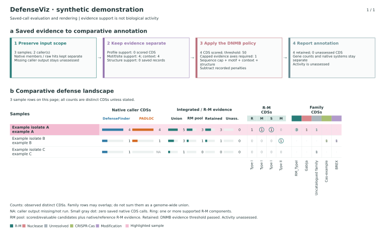

# DefenseViz

**Integrate saved defense annotations, reevaluate DNMB evidence, and draw editable comparative figures.**

DefenseViz 2 separates native caller output, DNMB evidence decisions, and visualization. It replaces the old folder-dependent `DefenseFinder_Heatmap()` workflow with explicit, portable inputs. Arbitrary sample identifiers, cohort sizes and previously unseen defense families are supported. Figure 2 **a** describes the evidence workflow; **b** shows caller CDS counts, R-M input/retention and components, defense-family profiles and highlighted samples.



## Install and try

Python 3.10 or newer. Run inside a virtual environment:

```sh
git clone https://github.com/JAEYOONSUNG/DefenseViz-next.git
cd DefenseViz-next
python -m venv .venv
# macOS/Linux
. .venv/bin/activate
# Windows PowerShell: .venv\Scripts\Activate.ps1
python -m pip install .
defenseviz demo --out demo-output
```

Open `demo-output/results/figure2_ab.pdf`. The SVG export preserves text and vector shapes for editing. The demo includes small, entirely synthetic inputs in `demo-output/inputs/`; copy them as a starting point. No databases, detector installation or network access are required after installation.

## Use your results

```sh
defenseviz validate project.json
defenseviz run project.json --out results
```

All paths inside `project.json` are relative to that file. Existing outputs are never overwritten. Use a new output directory for each run.

```json
{
  "schema_version": 1,
  "samples": "samples.tsv",
  "calls": [
    {"format": "defensefinder", "path": "sampleA/defense_finder_genes.tsv", "sample_id": "sampleA"},
    {"format": "padloc", "path": "sampleA/padloc.csv", "sample_id": "sampleA"}
  ],
  "coverage": "coverage.tsv",
  "family_map": "families.tsv",
  "evidence": "evidence.json",
  "options": {"title": "My defense landscape", "max_rows_per_page": 40, "max_families_per_page": 24}
}
```

A normalized call table is also supported. `samples.tsv` supplies sample IDs and display labels; an optional `highlight` column accepts booleans and uses a pink row background. Caller coverage explicitly distinguishes a completed zero-call result from a missing/not-run result. Exact ID mapping is required when caller protein IDs differ from evidence gene IDs. Unknown families remain visible as unresolved; names alone do not establish biochemical roles.

See [input formats](docs/inputs.md), [evidence policy](docs/evidence.md), [figure semantics](docs/figures.md), and the [API contract](docs/CONTRACT.md). Excel input support is optional: `python -m pip install '.[excel]'`.

## What is computed

- Distinct gene-level unions and exact caller overlaps; native system counts remain caller-specific.
- Fresh evaluation of **supplied evidence** with the versioned DNMB policy. Sequence-related points are capped, motif/context/structure axes remain distinct, and unsupported/missing evidence stays unassessed.
- Panel a/b PDF and SVG, paginated for larger cohorts; normalized calls, decisions, summary and component tables; a machine-readable analysis and receipt with hashes, software versions, exact command and timing.

The renderer does not run DefenseFinder, PADLOC, DefensePredictor, REBASE searches or structure prediction. Raw HMM hits are evidence records, not selected native system members. Component annotation is not a demonstration of biological activity. Distinct R/M/S counts are not automatically complete systems. Caller agreement is not ground truth, and no broad sensitivity, specificity or precision estimates are emitted.

An optional `evidence_extension` links a source-bound family registry, candidate domain/reference evidence and family-level admission rules into the same score evaluation. Run `defenseviz assess --registry registry.json --candidates candidates.json --out assessed` to inspect these evidence layers separately. See [the reference-extension example](examples/reference_extension/README.md).

The bundled DNMB preset reproduces the selected historical evidence policy. Some evidence criteria were historically calibrated; the preset is **not independent validation on a new population**, and this project performs no new threshold fitting. A bare native caller file cannot reconstruct motif, structural or other evidence that the caller did not provide.

## Reproducibility and development

```sh
python -m pip install '.[dev,excel]'
python -m pytest -q
python scripts/check_install.py
```

See [source provenance](docs/PROVENANCE.md) and [release validation](docs/VALIDATION.md) for migration, historical parity, independent critique and current limitations. Only synthetic demonstration data belong in this repository. Original analysis projects and frozen evidence are not modified or redistributed.

License: MIT. Copyright 2026 Jae-Yoon Sung.
