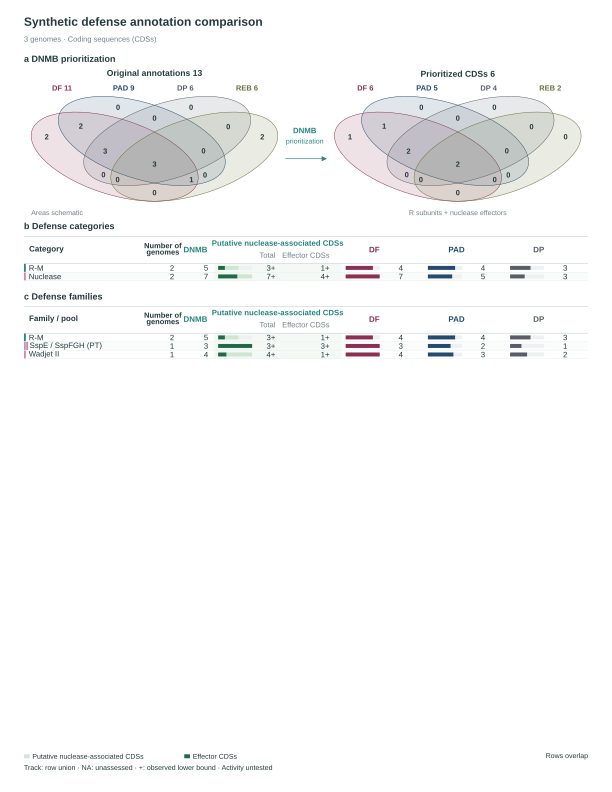

# DefenseViz

**Turn saved DNMBsuite results into traceable defense inventories and editable publication figures.**

DefenseViz separates original tool output, saved DNMB decisions, component evidence and visualization. Version 2.1.2 retains the manuscript's five-card workflow (a) and detailed defense landscape (b) as the default DNMBsuite view, alongside R-M type tables, original/prioritized overlaps and category/family comparisons. Samples, counts and evidence come from the supplied results; the layout has no built-in cohort or target-strain/transformability legends. Optional sample annotations need explicit labels. The earlier normalized-project evaluation workflow remains available.



[View the synthetic manuscript-style atlas](docs/assets/suite-atlas.svg). Missing saved evidence remains visibly unassessed; the example does not invent reviewed manuscript results.

## Install and try

Python 3.10 or newer. Run inside a virtual environment:

```sh
git clone https://github.com/JAEYOONSUNG/DefenseViz.git
cd DefenseViz
python -m venv .venv
# macOS/Linux
. .venv/bin/activate
# Windows PowerShell: .venv\Scripts\Activate.ps1
python -m pip install '.[suite]'
defenseviz demo --suite --out suite-demo
```

Open `suite-demo/results/figures/publication.pdf`; editable SVG pages are alongside
it. The entirely synthetic inputs in `suite-demo/inputs/` demonstrate completed
zero outputs, reference-only matches, saved retention and a complete annotated
effector core. No databases, detector installation or network access are required
after installation. `defenseviz demo --out demo-output` runs the earlier
normalized-project example.

## Use your results

For **DNMBsuite result directories**:

```sh
defenseviz inspect-suite /path/to/DNMBsuite_outputs
defenseviz from-suite /path/to/DNMBsuite_outputs --out results
```

Use a single genome output folder or a parent containing per-genome folders. Optional manifests choose samples, labels and pink highlights. Saved RDS completion metadata can be read with Rscript; it never runs the analysis engine. Native and later reviewed evidence remain distinct. Older exports without saved curation fields stay unassessed rather than receiving invented decisions. See [the DNMBsuite guide](docs/suite.md) and [saved-result contract](docs/SUITE_CONTRACT.md).

For an existing **normalized project**:

```sh
defenseviz validate project.json
defenseviz run project.json --out results
```

All paths inside `project.json` are relative to that file. Existing outputs are never overwritten. Use a new output directory for each run.

```json
{
  "schema_version": 1,
  "samples": "samples.tsv",
  "calls": [
    {"format": "defensefinder", "path": "sampleA/defense_finder_genes.tsv", "sample_id": "sampleA"},
    {"format": "padloc", "path": "sampleA/padloc.csv", "sample_id": "sampleA"}
  ],
  "coverage": "coverage.tsv",
  "family_map": "families.tsv",
  "evidence": "evidence.json",
  "options": {"title": "My defense landscape", "max_rows_per_page": 40, "max_families_per_page": 24}
}
```

A normalized call table is also supported. `samples.tsv` supplies sample IDs and display labels; an optional `highlight` column accepts booleans and uses a pink row background. Caller coverage explicitly distinguishes a completed zero-call result from a missing/not-run result. Exact ID mapping is required when caller protein IDs differ from evidence gene IDs. Unknown families remain visible as unresolved; names alone do not establish biochemical roles.

See [input formats](docs/inputs.md), [evidence policy](docs/evidence.md), [figure semantics](docs/figures.md), and the [API contract](docs/CONTRACT.md). Excel input support is optional: `python -m pip install '.[excel]'`.

## What is computed

- Distinct gene-level unions and exact caller overlaps; native system counts remain caller-specific.
- Fresh evaluation of **supplied evidence** with the versioned DNMB policy. Sequence-related points are capped, motif/context/structure axes remain distinct, and unsupported/missing evidence stays unassessed.
- Saved-result mode preserves DNMB decisions and counts individual effectors separately from required complex cores and motif/site evidence. Explicit source-bound reviews can supplement older results; stale input/protein hashes are rejected.
- Editable PDF and SVG, paginated for larger cohorts; right-aligned comparison counts with separate associated Total and Effector CDSs columns; machine-readable inventories, priorities, layout measurements and provenance receipts.

DefenseViz does not run DefenseFinder, PADLOC, DefensePredictor, REBASE searches or structure prediction. Raw HMM hits are evidence records, not selected native system members. Component annotation is not a demonstration of biological activity. Distinct R/M/S counts are not automatically complete systems. Tool agreement is not ground truth, and no broad sensitivity, specificity or precision estimates are emitted.

An optional `evidence_extension` links a source-bound family registry, candidate domain/reference evidence and family-level admission rules into the same score evaluation. Run `defenseviz assess --registry registry.json --candidates candidates.json --out assessed` to inspect these evidence layers separately. See [the reference-extension example](examples/reference_extension/README.md).

The bundled DNMB preset reproduces the selected historical evidence policy. Some evidence criteria were historically calibrated; the preset is **not independent validation on a new population**, and this project performs no new threshold fitting. A bare native caller file cannot reconstruct motif, structural or other evidence that the caller did not provide.

## Reproducibility and development

```sh
python -m pip install '.[dev,excel]'
python -m pytest -q
python scripts/check_install.py
```

See [source provenance](docs/PROVENANCE.md) and [release validation](docs/VALIDATION.md) for migration, historical parity, independent critique and current limitations. Only synthetic demonstration data belong in this repository. Original analysis projects and frozen evidence are not modified or redistributed.

The original R implementation remains available on the [`master` branch](https://github.com/JAEYOONSUNG/DefenseViz/tree/master); DefenseViz 2, implemented in Python, lives on `main`.

License: MIT. Copyright 2026 Jae-Yoon Sung.
